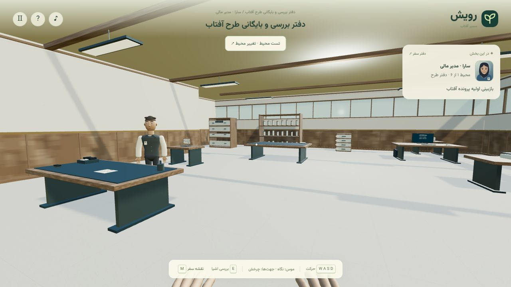
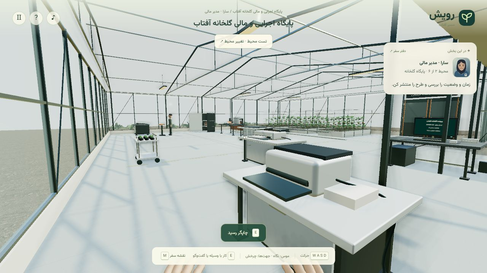
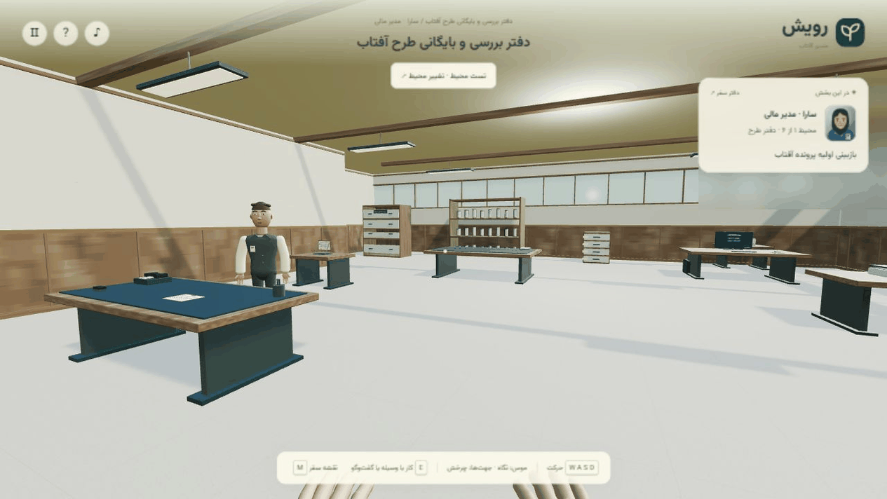

# Rooyesh — Path of the Sun | رویش؛ مسیر آفتاب

A Persian first-person 3D learning game about crowdfunding operations. Players explore workplaces, handle documents and equipment, and practice the responsibilities of a financial manager, an issuer representative, an individual investor, and a corporate investor.

**Status:** playable prototype under active development. All six redesigned environments are playable locally. The campaign contains ten business chapters and twenty validated decisions, carried out through workplace equipment, physical documents and role handoffs. Further visual polish and usability review are ongoing.

## Gameplay preview

<picture><source media="(prefers-reduced-motion: reduce)" srcset="docs/screenshots/portfolio-poster.png" /><source type="image/webp" srcset="docs/screenshots/portfolio.webp" /></picture>

Earlier first-office environment-test capture showing entry, movement and the journal. The current game includes all six redesigned environments. This recording shows an earlier build.

[Reproduce this capture and view the static image](docs/PORTFOLIO-PREVIEW.md)

## What it teaches

The scenario follows project review, issuer commitment, receipt submission and publication, individual and corporate participation, bank reconciliation, receipt validation, submission tracking, final approvals, certificates, and post-funding obligations. It separates payment success from submission success, capacity completion from final approval, and a scheduled obligation from an actual payment.

All identities, amounts, payments, and external-system responses are synthetic and local. There are no live bank, payment, identity-verification, or Farabourse integrations. Scenario thresholds illustrate this exercise and are not general legal or investment guidance. No learning-effectiveness study or user-adoption metric is claimed.

## Play locally

Requires Node.js 22+ and a modern desktop browser with WebGL support. Runtime dependencies and assets are vendored locally; no npm install or external service is required to play after obtaining the repository and Node.js.

    npm start

Open http://127.0.0.1:4318 . On Windows, Start.cmd starts the same local server and opens the browser; Stop.cmd stops the process started by that launcher. The launcher uses runtime/node.exe when locally available, otherwise Node.js from PATH. The executable itself is excluded from source control.

The start screen offers a normal saved journey and independent test entry points for all six environments. A seventh test option starts outside the final office, with the courtyard door open, for testing the ribbon-cutting conclusion. Environment tests keep the main saved journey separate.

## Controls

- W A S D or up/down arrows: movement; left/right arrows: turn.
- PageUp / PageDown: look up/down. Mouse look is optional.
- E or Space: interact with a nearby object or character in view.
- Inside a panel: Tab / Shift+Tab or arrows to navigate; E / Enter / Space to activate or toggle; Escape to close.
- M: journal; Escape: pause; H: hide the HUD.

Players can complete the interactions with a keyboard, use optional contextual guides, inspect carried documents with R, and approach desks and people from multiple directions. Directional equipment requires working from its front. Documents move between printers, scanners, filing locations and the hands of the appropriate character. Physical handoffs turn the receiving character toward the player and transfer the point of view.

## Six connected environments

| Environment | Business workflow and interactions |
| --- | --- |
| Project review and archive | Identify the correct project dossier, compare its terms, print a reconciliation sheet, scan and attach it, review the permitted dates and hand the reviewed file to the issuer representative. |
| Issuer greenhouse and financial office | Verify the issuer, calculate its 120-million-toman commitment, register either one 120-million receipt or two receipts of 100 and 20 million, scan and file the originals, hand the dossier to the manager, submit it and publish the project after the required response. |
| Individual participation branch | Verify identity with a fingerprint reader, register a 200-million-toman receipt purchase, create a separate 80-million gateway request with a local randomized OTP displayed on a modeled phone, print and assemble the documents, and hand them to the manager. |
| Financial operations centre | Reconcile the bank response, examine and scan the original receipt, query the online purchase's existing registration, submit only the paper receipt, print the results and complete the project dossier. |
| Contracts and certificate pavilion | Verify the corporate investor and its representative, calculate the remaining 600-million capacity, register 60 units, scan the treasury receipt, sign and exchange documents, close fundraising, reconcile final approvals, print and emboss the individual investor's 280-million certificate and archive the signed acknowledgement. |
| Obligations and settlement office | Read the contract, register four quarterly payments of 60 million at a 24% annual rate over 12 months, automatically print the schedule, advance the physical calendar device by three Persian months, receive and scan the bank document and reconcile only the first payment. Three obligations remain open. A courtyard ribbon-cutting sequence leads to the final ledger summary. |

Players take the roles of Shabnam, financial manager; Nader, issuer representative; Mani, individual investor; and Ghazaleh, corporate-investor representative. Guide conversations are optional and business prerequisites are enforced by the domain state machine.

## Implementation

- JavaScript ES modules, Three.js/WebGL, procedural scene construction, locally bundled glTF/PBR/HDR assets, HTML/CSS and Persian RTL interface.
- A separate domain state machine validates identity, amounts, capacity, receipts, sequencing, reconciliation and obligations.
- Validated events reconstruct saved progress; local browser storage is a convenience, not a protected examination or authorization system.
- Frame-rate-independent movement/collision, scene caching, instancing, LOD and an adaptive render budget control runtime cost.
- A dependency-free Node.js loopback server serves local assets and restricts methods and file access.

## Repository map

| Path | Purpose |
| --- | --- |
| [app/](app/) | Browser client, scene/interaction code and local runtime assets |
| [scripts/server.mjs](scripts/server.mjs) | Loopback-only static server used by npm start |
| [tests/](tests/) | Node.js domain, storage, scene and interaction regressions |
| [docs/](docs/) | Current environment references, interaction standards and historical development reports |
| [THIRD-PARTY-NOTICES.md](THIRD-PARTY-NOTICES.md) | Library and asset notices |

For a fresh checkout, use the declared Node.js prerequisite, run `npm test`, then `npm start` and perform the office/keyboard smoke checks described above. Runtime libraries are vendored, so these commands do not need an npm dependency installation. This is a local browser prototype; it does not connect to a real financial database or payment system.

## Verification and development

    npm test

The latest local verification on 2026-11-07 passed **444 Node.js tests** and **40 Python maintenance tests**. Coverage includes valid and invalid progression, duplicate-action prevention, capacity and payment rules, interrupted-operation replay, local saves, device access, movement and collision, resource integrity, and scene-animation regressions. The two GitHub Actions jobs run the game suite on Node.js 22 and 24.

Browser review covered entry into all six environments, the final office drawer, the courtyard sequence and the resulting financial summary, without recorded JavaScript errors. A complete manual playthrough of every mission has not yet been performed. Automated checks do not establish visual correctness on every device or measured learning effectiveness.

Static geometry is instanced while animated equipment remains independent. In the obligations-scene regression fixture, batching reduced render meshes from 468 to 241; this is a scene-structure measurement rather than a device frame-rate benchmark.

Start with [the six-environment plan](docs/SIX-ENVIRONMENT-REALISTIC-WORKFLOW.md), [interaction standards](docs/INTERACTION-STANDARD.md), [the office review](docs/OFFICE-ENVIRONMENT-REVIEW.md), and [the issuer greenhouse review](docs/ISSUER-ENVIRONMENT-REVIEW.md), and [the participation branch review](docs/PARTICIPATION-ENVIRONMENT-REVIEW.md). Detailed project memory is maintained separately in Obsidian. Older environment reports describe earlier iterations, including a retired wrong-door mechanic; they do not override the six-environment plan.

## Rights and third-party assets

Public availability does not grant a project-wide open-source license. Third-party code and assets retain their respective licenses and attribution; see [THIRD-PARTY-NOTICES.md](THIRD-PARTY-NOTICES.md). Environment assets include Poly Haven CC0 resources; Three.js and related utilities carry their bundled notices; the Mixamo-derived character has separate usage terms and is not an independently licensed asset library.

---

بازی آموزشی مستقل سه‌بعدی برای تجربهٔ عملی فرایند تأمین مالی جمعی است. هر شش محیط بازطراحی‌شده قابل اجرا هستند. بازیکن با چهار نقش، از بررسی پرونده تا ثبت خرید، تطبیق بانکی، صدور گواهی و اولین پرداخت سود پیش می‌رود. نسخهٔ قابل‌بازی همچنان در حال توسعه و بازبینی کیفیت است. تمام عملیات مالی ساختگی و محلی‌اند.

## Continuous integration

GitHub Actions runs `npm test` on Node.js 22 and 24 using the vendored runtime assets; no npm dependency installation is needed. This checks the existing automated regression suite, not visual WebGL behavior, performance or a deployed environment.

The [CI workflow](.github/workflows/ci.yml) runs for pull requests and pushes to `main`, and can be started manually. It uses read-only repository permissions and does not deploy the project.

## Maintenance checks

The existing CI also runs weekly on Monday and checks tracked Markdown file destinations with `scripts/check_doc_links.py`. Its negative tests cover moved documents, missing picture variants, paths outside the repository and untracked local drafts. External URLs and heading fragments are intentionally outside this offline file check. Scheduled runs do not deploy or start original application hosts.

The vendored Three.js core/module match the official npm 0.180.0 release and are hash-guarded in `docs/runtime-advisories.json`. CI queries current reviewed advisories for that exact version. No game rules, environments or financial workflows change in this maintenance group.

Local anchor validation and weekly public URL monitoring are documented in [link health](docs/LINK-HEALTH.md).
