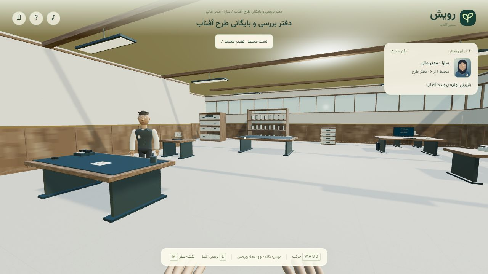
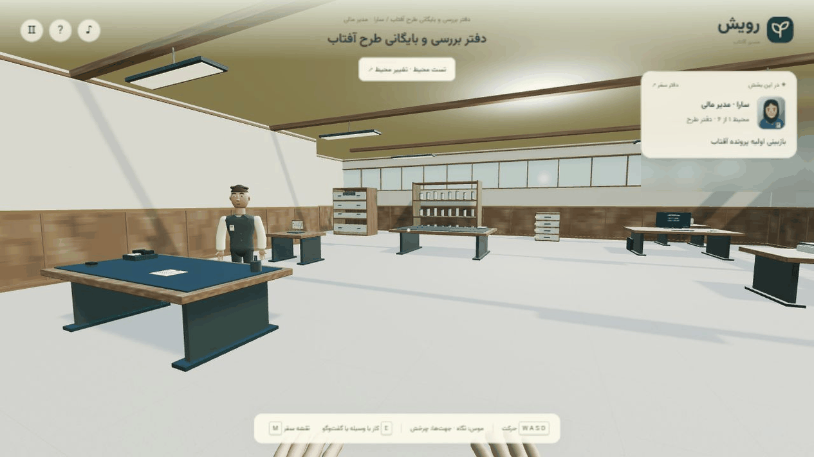

# Rooyesh — Path of the Sun | رویش؛ مسیر آفتاب

A Persian first-person 3D learning game about crowdfunding operations. Players explore workplaces, handle documents and equipment, and practice the responsibilities of a financial manager, an issuer representative, an individual investor, and a corporate investor.

**Status:** playable prototype under active development. The business-rule campaign contains ten chapters and twenty decisions. Its physical experience is being consolidated into six distinct environments. The redesigned first office is playable; the second environment's design is approved; the remaining environments still use legacy implementations. The six-environment redesign is not complete.

## Gameplay preview

<picture><source media="(prefers-reduced-motion: reduce)" srcset="docs/screenshots/portfolio-poster.png" /><source type="image/webp" srcset="docs/screenshots/portfolio.webp" /></picture>

Actual first-office environment-test capture: entering the room, walking, turning and opening the journal. Playable prototype under active development; the six-environment redesign remains incomplete.

[Reproduce this capture and view the static image](docs/PORTFOLIO-PREVIEW.md)

## What it teaches

The scenario follows project review, issuer commitment, receipt submission and publication, individual and corporate participation, bank reconciliation, receipt validation, submission tracking, final approvals, certificates, and post-funding obligations. It separates payment success from submission success, capacity completion from final approval, and a scheduled obligation from an actual payment.

All identities, amounts, payments, and external-system responses are synthetic and local. There are no live bank, payment, identity-verification, or Farabourse integrations. Scenario thresholds illustrate this exercise and are not general legal or investment guidance. No learning-effectiveness study or user-adoption metric is claimed.

## Play locally

Requires Node.js 22+ and a modern desktop browser with WebGL support. Runtime dependencies and assets are vendored locally; no npm install or external service is required to play after obtaining the repository and Node.js.

    npm start

Open http://127.0.0.1:4318 . On Windows, Start.cmd starts the same local server and opens the browser; Stop.cmd stops the process started by that launcher. The launcher uses runtime/node.exe when locally available, otherwise Node.js from PATH. The executable itself is excluded from source control.

On the start screen choose the first office under direct environment testing to explore it without changing the main saved journey. Five future redesign destinations are visible but disabled. The legacy environment atlas remains a preview of the earlier version.

## Controls

- W A S D or up/down arrows: movement; left/right arrows: turn.
- PageUp / PageDown: look up/down. Mouse look is optional.
- E or Space: interact with a nearby object or character in view.
- Inside a panel: Tab / Shift+Tab or arrows to navigate; E / Enter / Space to activate or toggle; Escape to close.
- M: journal; Escape: pause; H: hide the HUD.

The new office supports keyboard operation, contextual guide dialogue, camera-relative document carrying, multi-side desk/guide access, directional device access, animated drawers/folders, scanner movement and light, and computer feedback. Additional animation and character polish remain planned.

## Implementation

- JavaScript ES modules, Three.js/WebGL, procedural scene construction, locally bundled glTF/PBR/HDR assets, HTML/CSS and Persian RTL interface.
- A separate domain state machine validates identity, amounts, capacity, receipts, sequencing, reconciliation and obligations.
- Validated events reconstruct saved progress; local browser storage is a convenience, not a protected examination or authorization system.
- Frame-rate-independent movement/collision, scene caching, instancing, LOD and an adaptive render budget control runtime cost.
- A dependency-free Node.js loopback server serves local assets and restricts methods and file access.

## Repository map

| Path | Purpose |
| --- | --- |
| [app/](app/) | Browser client, scene/interaction code and local runtime assets |
| [scripts/server.mjs](scripts/server.mjs) | Loopback-only static server used by npm start |
| [tests/](tests/) | Node.js domain, storage, scene and interaction regressions |
| [docs/](docs/) | Current environment references, interaction standards and historical development reports |
| [THIRD-PARTY-NOTICES.md](THIRD-PARTY-NOTICES.md) | Library and asset notices |

For a fresh checkout, use the declared Node.js prerequisite, run `npm test`, then `npm start` and perform the office/keyboard smoke checks described above. Runtime libraries are vendored, so these commands do not need an npm dependency installation. This is a local browser prototype; it does not connect to a real financial database or payment system.

## Verification and development

    npm test

The latest recorded local suite contains **339 passing tests**. It covers domain progression, invalid/duplicate actions, receipt and payment rules, replay/storage, movement/collision, assets, and scene/interaction regressions. Local browser checks also cover the office workflow and keyboard interactions. Other devices, complete redesign coverage, and measured educational outcomes are not implied.

Start with [the current development reference](docs/ENVIRONMENT-UPGRADE-REFERENCE.md), [interaction standards](docs/INTERACTION-STANDARD.md), and [the office review](docs/OFFICE-ENVIRONMENT-REVIEW.md). Older environment reports describe earlier iterations, including a retired wrong-door mechanic; they do not override the six-environment plan.

## Rights and third-party assets

Public availability does not grant a project-wide open-source license. Third-party code and assets retain their respective licenses and attribution; see [THIRD-PARTY-NOTICES.md](THIRD-PARTY-NOTICES.md). Environment assets include Poly Haven CC0 resources; Three.js and related utilities carry their bundled notices; the Mixamo-derived character has separate usage terms and is not an independently licensed asset library.

---

بازی آموزشی مستقل برای تجربه عملی فرایند تأمین مالی جمعی است. نسخه فعلی قابل اجراست، اما بازطراحی شش محیط هنوز کامل نشده است. مرجع ادامه کار و وضعیت واقعی هر محیط در docs/ENVIRONMENT-UPGRADE-REFERENCE.md نگهداری می‌شود. تمام عملیات مالی ساختگی و محلی‌اند.

## Continuous integration

GitHub Actions runs `npm test` on Node.js 22 and 24 using the vendored runtime assets; no npm dependency installation is needed. This checks the existing automated regression suite, not visual WebGL behavior, performance or a deployed environment.

The [CI workflow](.github/workflows/ci.yml) runs for pull requests and pushes to `main`, and can be started manually. It uses read-only repository permissions and does not deploy the project.

## Maintenance checks

The existing CI also runs weekly on Monday and checks tracked Markdown file destinations with `scripts/check_doc_links.py`. Its negative tests cover moved documents, missing picture variants, paths outside the repository and untracked local drafts. External URLs and heading fragments are intentionally outside this offline file check. Scheduled runs do not deploy or start original application hosts.

The vendored Three.js core/module match the official npm 0.180.0 release and are hash-guarded in `docs/runtime-advisories.json`. CI queries current reviewed advisories for that exact version. No game rules, environments or financial workflows change in this maintenance group.
