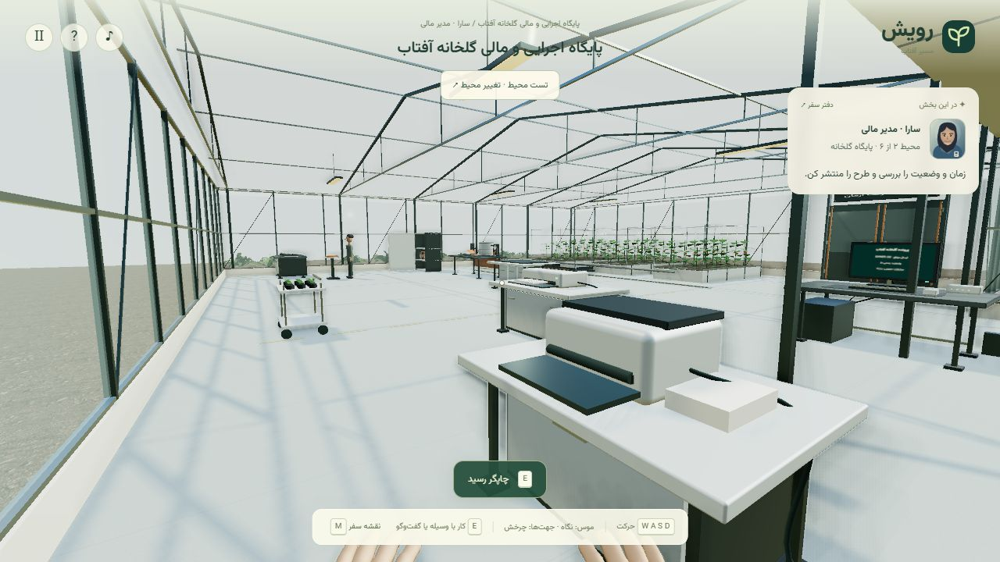

# بازبینی محیط دوم: پایگاه اجرایی و مالی گلخانه آفتاب

تاریخ: ۲۰۲۶-۱۱-۰۳

محدوده این تغییر، محیط دوم تأییدشده در [برنامه شش محیط](SIX-ENVIRONMENT-REALISTIC-WORKFLOW.md) است. چهار تصمیم ownerIdentity، ownerAmount، ownerSend و publish در یک فضای پیوسته انجام می‌شوند. در زمان تهیه اولیه این گزارش، محیط سوم جدید شروع نشده بود. اکنون خروج پایگاه به [خانه مشارکت آفتاب](PARTICIPATION-ENVIRONMENT-REVIEW.md) متصل است.

## عملیات

نادر با مینا، مسئول مالی گلخانه، گفت‌وگو می‌کند. پوشه آفتاب را از کمد برداشته و روی پیشخوان باز می‌کند؛ در رایانه هویت شرکت و مسیر سرمایه‌پذیر را انتخاب و ثبت می‌کند. پوشه مهتاب یا مسیر سرمایه‌گذار حقوقی در همین محل رد و اصلاح می‌شود.

ماشین‌حساب واقعیِ قابل استفاده، عبارت عددی، تقدم ضرب/تقسیم، درصد، اعشار، نتیجه و پاک‌کردن دارد و از eval استفاده نمی‌کند. نتیجه تعهد این سناریو ۱۲۰ میلیون است: ده درصد ۱۰۰۰ میلیون، به‌اضافه ۲۰ میلیون. محاسبه نادرست، ثبت مالی ایجاد نمی‌کند.

دو فیش پرداخت‌شده ۱۰۰ و ۲۰ میلیونی جداگانه بررسی و انتخاب می‌شوند. هرکدام روی تغذیه‌گر قرار می‌گیرد و با حرکت کاغذ، غلتک و نور از اسکنر عبور می‌کند. پس از پایان هر دو اسکن، بسته روی رایانه ثبت می‌شود؛ وجه دوباره دریافت نمی‌شود و هنوز ارسال انجام نشده است.

بسته ثبت‌شده از پیشخوان برداشته و در دست حمل می‌شود. تحویل نزدیک راهنما، آن را به سینی دارای پایه منتقل می‌کند؛ نقش پس از پایان تحویل از نادر به سارا تغییر می‌کند. ارسال از رایانه آغاز می‌شود و تا پایان انتظار پاسخ، دفتر مالی موفقیت ثبت نمی‌کند. پاسخ موفق با OWNER-OK، تعهد ۱۲۰ میلیونی را دقیقاً یک‌بار در پرداخت‌های سناریو ثبت می‌کند.

سارا رسید را چاپ می‌کند؛ غلتک و کاغذ خروجی حرکت می‌کنند. رسید تا زمان برداشت روی سینی می‌ماند و هنگام برداشت، به دست می‌آید و جمع می‌شود. پس از بررسی زمان و وضعیت روی رایانه، طرح برای مشارکت عمومی منتشر می‌شود. خروج از در، فقط مکان و نقش را به آرمان تغییر می‌دهد؛ ثبت یا ارسال مالی دیگری ایجاد نمی‌کند.

## معماری و تجهیزات

فضای شیشه‌ای با سقف شیب‌دار، خرپا، تیر و مهاربندهای دارای اتصال، ردیف‌های کشت، بستر رشد، برگ‌های خمیده دارای رگبرگ، میوه، نخ تکیه‌گاه و داربست دارد. مخزن حلقه‌دار، نشانگر سطح، پمپ، ورودی و خروجی، شیر، فشارسنج، شلنگ و منیفولد به خطوط قطره‌ای بسترها متصل‌اند. وضعیت آزمایشی آبیاری با فشارسنج و شیر بازخورد می‌دهد و جزو شروط مالی مأموریت نیست.

بخش خشک نامتقارن شامل کمد، پیشخوان پرونده و چراغ کار، ماشین‌حساب کنار پنجره، جزیره تفکیک فیش، اسکنر تغذیه‌برگ، رایانه و شبکه، چاپگر با محفظه کاغذ، چرخ نشا و سینی تحویل پایه‌دار است. کابل‌ها به جعبه اتصال یا خروجی زمینی منتهی می‌شوند. کف و دیوار شیشه‌ای مرز فیزیکی دارند؛ متن‌ها روی پرونده، فیش، پلاک و نمایشگرند و بنر آموزشی جای تجهیزات را نمی‌گیرد.

مینا هویت و پوشش مستقل و متناسب با مسئول مالی پایگاه دارد. پرداخت نهایی چهره، دست و لوازم بازیکن همچنان برای مرحله آخر است؛ سبک تصویر، سه‌بعدی سبک‌پردازی‌شده است و ادعای گرافیک واقع‌گرای کامل یا AAA مطرح نیست.

## کنترل و ذخیره

موس اختیاری است. پنل‌ها Tab، جهت‌ها، E، Enter، فاصله و Escape را پشتیبانی می‌کنند؛ ماشین‌حساب ورود مستقیم اعداد و عملگرها نیز دارد. فوکوس بعد از تغییر گزینه حفظ می‌شود و در توقف، ادامه سفر اولویت دارد. میز و راهنما از اضلاع قابل دسترسی و دستگاه‌ها از سمت کار فعال می‌شوند.

در شروع اسکن، چاپ، تحویل و برداشت رسید، پنل کنار می‌رود تا حرکت وسیله دیده شود؛ بازکردن دوباره پنل در زمان کار، وضعیت و پیشرفت را نشان می‌دهد. حالت کاهش حرکت، حرکت‌های نمایشی را ثابت یا کوتاه می‌کند و نتیجه عملیات را حفظ می‌کند. گفتار صوتی یا لب‌خوانی راهنما و فیزیک عمومی اشیا پیاده‌سازی نشده‌اند.

رویدادهای پایگاه مستقل بازپخش می‌شوند. job نیمه‌تمام بعد از ادامه سفر، چرخه همان عملیات را دوباره از ابتدا نمایش می‌دهد و نتیجه تجاری را تکراری ثبت نمی‌کند. مختصات پایگاه با نسخه چیدمان ۱۰۲ از دفتر و کارگاه قدیمی تفکیک می‌شود. سفرهای قدیمی میانی به مسیر قبلی خود ادامه می‌دهند؛ ورود به پایگاه جدید از پایان دفتر یا ورود مستقیم فعال است.

صفحه شروع شش مقصد دارد؛ سه محیط نخست آماده ورود مستقیم‌اند و سه مورد بعد منتظر بازطراحی هستند. تست مستقل، ذخیره اصلی را تغییر نمی‌دهد. تاریخچه سفر، تصمیم‌های تعهد و ارسال و تحویل و انتشار را با وجود یکسان‌بودن محیط فیزیکی نگه می‌دارد.

## شواهد بررسی و محدودیت

۲۰ آزمون اختصاصی پایگاه، موارد هویت و مسیر نادرست، ماشین‌حساب، دو فیش، ترتیب و انحصار عملیات، تغییر نقش، منع ارسال تکراری، چاپ/برداشت، مهلت و وضعیت انتشار، خروج بدون ثبت مالی دوم، بازپخش و عملیات نیمه‌تمام، ذخیره مشترک دفتر/پایگاه، حرکت و جهات دسترسی، حمل، حرکت کاغذ، بازخورد کلید و ساختار تجهیزات را بررسی می‌کنند.

در مرورگر داخلی ۱۲۸۰×۷۲۰، عملیات تا انتشار و خروج با کلیدهای واقعی پنل‌ها انجام شد. نقاط ایستادن با ابزار موقت بررسی جابه‌جا شدند؛ پیمایش جداگانه بین همه تجهیزات با حرکت و برخورد واقعی کامل شد. مسیر نادرست هویت و دریافت راهنمای اصلاح از کنار شخصیت، و قراردادن پرونده از پشت پیشخوان نیز بررسی شدند. عبور واقعی از دفتر به پایگاه و از پایگاه به پذیرش قبلی انجام شد. بررسی مستقل نهایی چاپ و حرکت برداشت رسید و نمای نزدیک صحنه نیز اجرا شد. ذخیره اصلی بدون تغییر ماند و اجرای تمیز نهایی خطا یا هشدار مرورگر نداشت.

عملکرد مشاهده‌شده در حالت تطبیقی حدود ۴۷ تا ۶۰ فریم با وضوح داخلی متغیر بود؛ نمای کیفیت بالا نیز بررسی شد. این اعداد تضمین دستگاه دیگر نیستند. ورودی صوتی، بررسی شنیداری مستقل، اجرای کامل تمام محیط‌های آینده و تأیید تصویری نهایی کاربر در این نوبت انجام نشده‌اند. ابزارهای موقت بررسی در نسخه تحویلی حذف می‌شوند.

