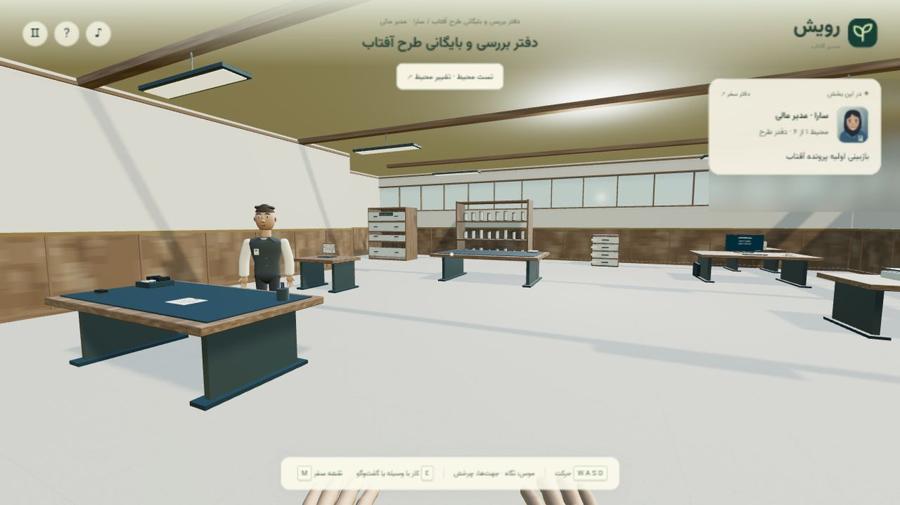

# Rooyesh · Path of the Sun · captured evidence

Actual first-office environment-test capture: entering the room, walking, turning and opening the journal. Playable prototype under active development; the six-environment redesign remains incomplete.



[Animated WebP](screenshots/portfolio.webp) · [GIF fallback](screenshots/portfolio.gif)

## Reproduce locally

Requires Node.js 22+ and a desktop browser with WebGL. From the repository root:

```powershell
node scripts/server.mjs --port=8846
```

Open `http://127.0.0.1:8846/`. Choose the first office under direct environment testing. Walk with WASD, turn with left/right arrows and open the journal. Stop the server with Ctrl+C. Use a distinct port to keep this test origin separate from an existing saved journey.

The capture used source tree `ad0f5b7e2f605a42776a119d73d111cad523055e`, identical to public commit `c5c595b23368fbf18228b358c45ba824df5c926a`. No game code or game state was altered to manufacture a scene. The tour is a sequence of captured states, not continuous video or a completed campaign. Only the redesigned first office is shown. Character/hand polish and the remaining redesign are not presented as complete.

## Evidence boundary

Captured on 2026-10-28 from the checked-in implementation and clearly marked sample inputs. Animated media concatenates actual captured UI states with readable dwell times; it does not simulate a completed transaction. No production, cloud, database, payment, identity or email operation is implied. Static PNG is available above for reduced motion.
