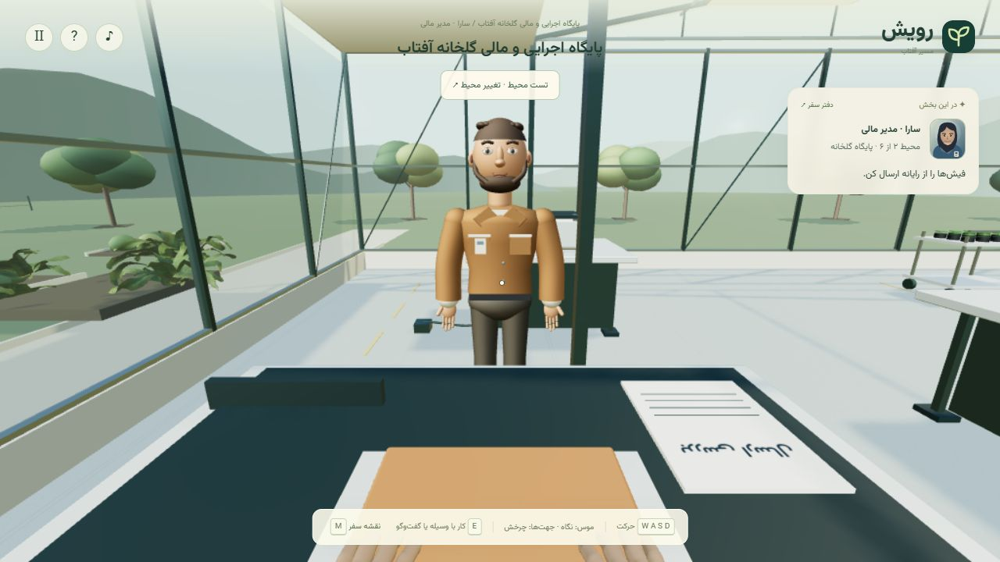

# راهنمای اختیاری و تحویل بین شخصیت‌ها

تاریخ: ۲۰۲۶-۱۱-۰۳

## رفتار دو محیط نخست

گفت‌وگو با نیما در دفتر و مینا در گلخانه اختیاری است. راهنما توضیح متناسب با وضعیت می‌دهد و عملیات مالی یا پیش‌نیاز لازم برای شروع کار ایجاد نمی‌کند. بازیکن آشنا می‌تواند مراحل ابزارها را بدون refer یا intro انجام دهد.

تحویل کاری از راهنمایی جداست. در دفتر، پس از بازبینی، سارا بسته نتیجه را از میز بررسی برمی‌دارد و به نادر پشت میز مخصوص او تحویل می‌دهد. در گلخانه، نادر بسته ثبت‌شده را از پیشخوان برمی‌دارد و به سارا پشت میز بخش مالی می‌دهد. این دو میز دارای سینی، مدارک شغلی، پلاک و کیف‌اند؛ مینا میز خدماتی مستقل دارد و نیما در میز بایگانی خودش باقی می‌ماند.

حرکت سند از دست به سمت گیرنده، حرکت بازو و دست گیرنده، قرارگیری سند روی سینی و انتقال دید در یک چرخه زمان‌دار انجام می‌شوند. شخصیت مقصد پیش از تحویل حضور دارد؛ پس از پایان، دید و نقش از محل او ادامه می‌یابد و شخصیت قبلی در محل واقعی شروع تحویل باقی می‌ماند. هنگام حرکت دید، دست‌های اول‌شخص کنار می‌روند؛ پس از پایان، دست و پوشش نقش جدید فعال می‌شوند. اعلان تغییر نقش در گوشه قرار دارد تا شخصیت قبلی را نپوشاند.

حرکت بازیکن هنگام تحویل قفل و با پایان آن آزاد می‌شود. منوی توقف یا پنهان‌شدن صفحه، پیشرفت تحویل را متوقف می‌کند. سفر نیمه‌تمام با بازپخش معتبر بازسازی و انیمیشن از ابتدا نمایش داده می‌شود؛ ثبت مالی تکرار نمی‌شود. کاهش حرکت، جابه‌جایی نمایشی دید را حذف می‌کند. رفتار رویدادهای قدیمی handoff در دفتر برای خواندن ذخیره‌های قبلی حفظ شده است؛ رابط جدید از handoff-start و handoff-finish استفاده می‌کند.

برنامه محیط‌های آینده در [برنامه شش محیط](SIX-ENVIRONMENT-REALISTIC-WORKFLOW.md) و قواعد تفصیلی در حافظه پروژه Obsidian ثبت شده است. محیط سوم شروع نشده است.

## شواهد

- هر ۳۷۲ تست Node پس از حذف ابزار موقت موفق بود؛ ۸ آزمون جدید جریان کامل دو محیط بدون راهنما، انتقال نقش، بازپخش، حفظ دفتر مالی، محل سند و سینی، برخورد، مسیر و مدل هر دو شخصیت را بررسی می‌کنند.
- در مرورگر داخلی، تحویل واقعی دفتر و گلخانه با کلیدهای پنل اجرا شد. پیش‌نیازها و نقطه ایستادن برای این بررسی با ابزار موقت و توابع معتبر بازی آماده شدند؛ کل مأموریت‌ها دوباره در مرورگر پیمایش نشدند.
- در گلخانه، توقف در میانه تحویل، ادامه از همان عملیات و حرکت واقعی پس از تغییر نقش بررسی شد. در هر دو محیط حضور شخصیت قبلی از دید گیرنده دیده شد. خطا و هشدار مرورگر در اجرای بررسی ثبت نشد.
- بررسی کامل نحوی و diff انجام شد. همه ابزارهای موقت از نسخه تحویلی حذف شدند. Git در این نشست stage، commit یا push نشد.

پرداخت نهایی مدل شخصیت‌ها، دست‌ها و لوازم همچنان برای مرحله آخر و تأیید تصویری کاربر باقی است. ادعای بررسی همه دستگاه‌ها، فیزیک عمومی بدن یا تکمیل شش محیط مطرح نیست.

